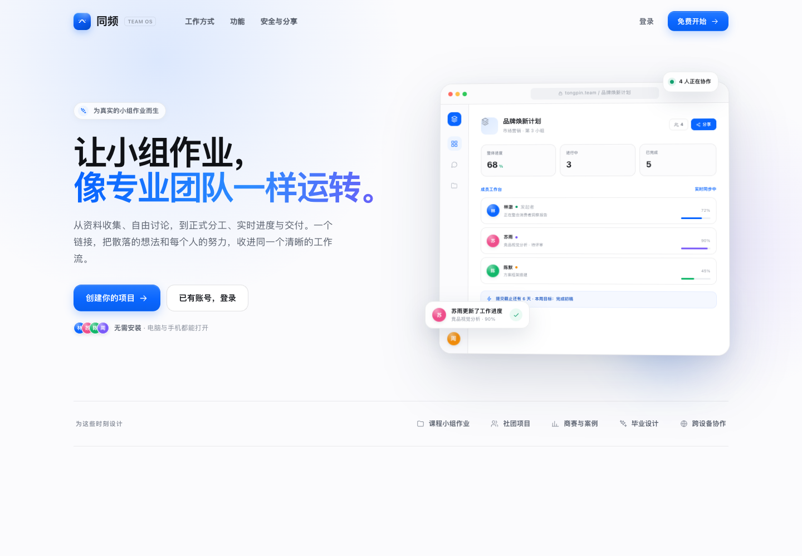
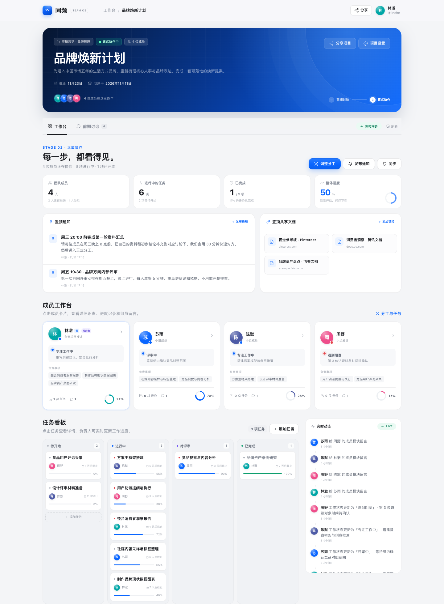
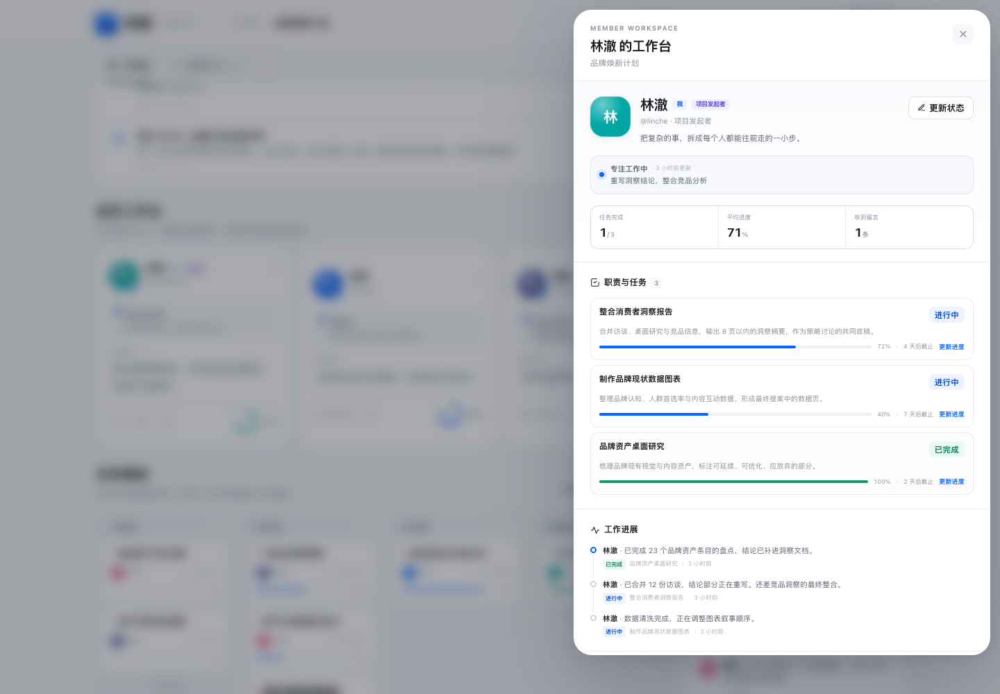
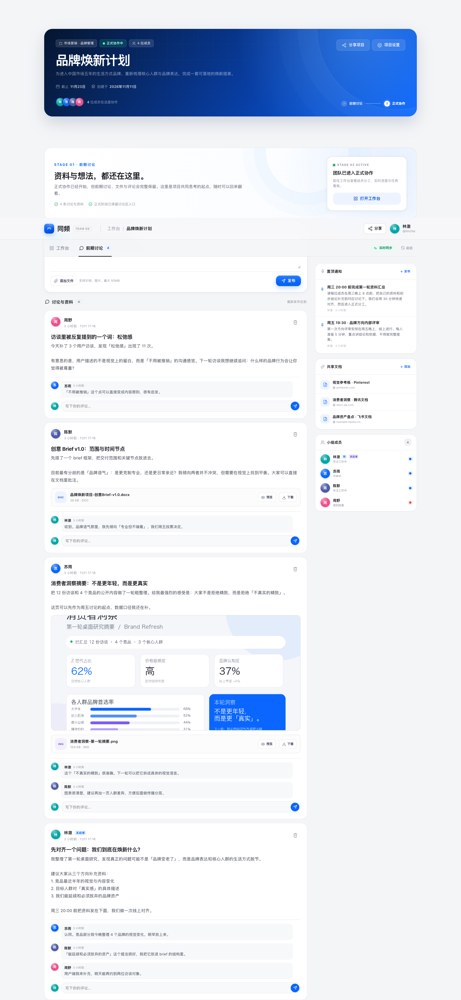
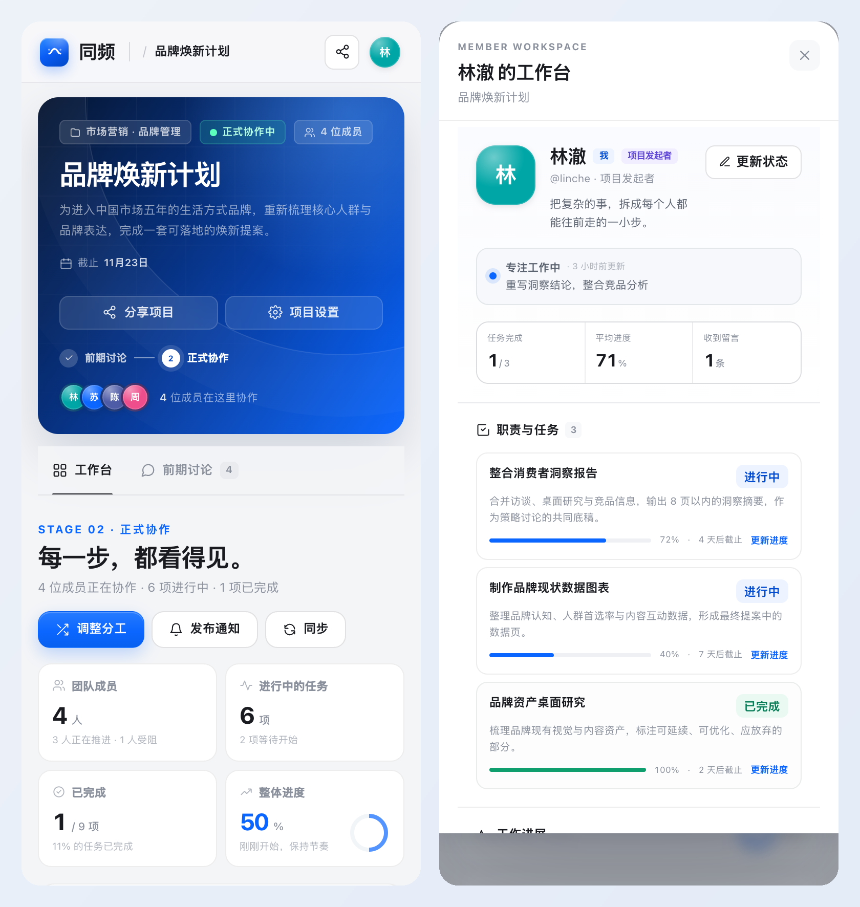

# 同频 Tongpin

> 把公司里的工作流，带进小组作业。
>
> 从资料收集、自由讨论，到正式分工、实时进度与交付，一个链接把所有人和每一步收进同一条清晰的工作流。



## 免费持久化架构

这个版本可以 **0 月费** 长期保存数据：

- **计算**：Render Free Web Service
- **数据库**：SQLite 快照自动同步到 Supabase Storage
- **上传文件**：直接存入 Supabase Storage 私有桶
- **重启恢复**：Render 实例冷启动或重新部署时，从 Supabase 拉回最新数据库快照

每次有效写入后都会生成一次一致性快照并上传；优雅关闭时还会再做一次最终备份。  
极端情况下（进程被立即杀死且最后几秒的备份还没完成），可能损失最后一次操作，但不会出现整库丢失。

> 这是针对小团队的轻量方案。若未来需要更高并发、多人同时大量写入，建议迁移到 PostgreSQL。

## 演示账号

在本地或临时测试环境执行：

```bash
npm run seed
```

会生成：

- 发起者：`linche` / `tongpin2026`
- 成员：`suyu`、`chenmo`、`zhouye`，密码相同
- 示例项目：「品牌焕新计划」，项目密码 `team2026`
- 项目邀请链接会在脚本结束时打印

正式部署时不要执行 seed，直接注册真实账号。

## 核心能力

1. **账号与个人主页**：用户名 + 密码登录，密码使用 `scrypt` 加盐哈希；登录后进入个人工作台，查看进行中项目、已结束项目、待推进任务和个人资料。
2. **项目链接 + 密码**：发起者创建项目时设置密码，系统生成项目邀请链接；成员使用「链接 + 密码」加入。发起者可修改密码、重置链接、结束并归档项目。
3. **前期讨论与资料**：贴吧式讨论版，发布文字、图片、Word、PDF、PPT、Excel、压缩包等；支持评论、在线预览与下载。正式阶段后内容完整保留。
4. **手动开启正式协作**：只有发起者可以点击开启按钮；开启后解锁工作台，前期讨论仍可随时回看。
5. **分工**：支持「随机抽取」和「主动分配」两种方式，可设置负责人、优先级、截止日期和职责说明。
6. **成员工作台**：每位成员拥有独立模块，显示当前状态、正在做的事、负责事项和平均进度；点击进入详细任务、进展时间线，并可互相留言。
7. **任务看板与实时动态**：待开始 / 进行中 / 待评审 / 已完成，状态和进度实时同步，所有操作记录在实时动态中。
8. **置顶通知与共享文档**：发起者发布置顶通知，成员可添加腾讯文档、飞书、Notion 等在线文档链接。
9. **响应式界面**：Apple 式的克制排版与钉钉式办公信息层级；桌面、平板和手机均可使用。



<details>
<summary>查看成员专属工作台</summary>



</details>

<details>
<summary>查看前期讨论版</summary>



</details>



## 技术栈

- **后端**：Node.js 24 · Express 4 · `node:sqlite`
- **前端**：原生 HTML / CSS / JavaScript，无构建步骤、无 CDN
- **实时**：Server-Sent Events + 轮询兜底
- **持久化**：Supabase Storage（私有桶）· SQLite 一致性快照
- **部署**：Render Free · Dockerfile · GitHub Actions
- **安全**：`scrypt` 哈希、HttpOnly 会话 Cookie、项目成员鉴权、速率限制、文件类型/大小限制、CSP、`nosniff`、`X-Frame-Options: DENY`

## 本地运行

要求 **Node.js 24+**。

```bash
npm install
npm start
```

访问 <http://localhost:3000>。

### 本地普通模式

不设置 Supabase 环境变量时，数据保存在：

```text
data/tongpin.db
uploads/
```

适合开发和本地演示。

### 本地测试云持久化

在 Supabase 创建项目后，用环境变量启动：

```bash
SUPABASE_URL="https://xxxx.supabase.co" \
SUPABASE_SERVICE_ROLE_KEY="你的 service_role key" \
SUPABASE_BUCKET=tongpin \
npm start
```

首次启动会自动创建私有存储桶 `tongpin`，随后：

- 有快照时自动恢复数据库
- 上传文件写入 Supabase
- 数据写入后自动备份数据库快照

## 部署到公网（零月费）

### 先说明：为什么不能只用 GitHub Pages

GitHub Pages 只能托管静态文件，无法运行 Node 服务、处理登录会话和文件上传。  
GitHub 用来保存源码；运行和持久化由 **Render Free + Supabase Free** 负责。

### 1. 创建 Supabase 项目

1. 打开 <https://supabase.com/dashboard> 并登录。
2. **New project** → 选择 Free 计划。
3. 项目名建议 `tongpin`，区域选择离你和组员较近的地区。
4. 等待项目初始化完成。
5. 进入 **Project Settings → API**，复制：
   - **Project URL**
   - **service_role** 密钥（不是 `anon` key）

`service_role` 权限很高，只能填写在服务端环境变量中，**不要提交到 GitHub，也不要发到聊天里**。

不需要手动创建存储桶，应用首次启动会自动创建私有桶 `tongpin`。

### 2. 把代码推送到 GitHub

仓库已经是完整的 Git 仓库，可直接推送：

```bash
cd projects/tongpin_2026-11-11
git remote add origin https://github.com/<你的用户名>/<仓库名>.git
git push -u origin main
```

本次开发对应的仓库：<https://github.com/xiezhongjin462-dotcom/tongpin>

### 3. Render 部署

1. 打开 <https://render.com>，用 GitHub 登录。
2. **New → Blueprint**。
3. 选择 `tongpin` 仓库，Render 会读取根目录的 [`render.yaml`](render.yaml)。
4. 按提示填写两个环境变量：
   ```text
   SUPABASE_URL=你的 Project URL
   SUPABASE_SERVICE_ROLE_KEY=你的 service_role key
   ```
5. 选择 **Free** 实例并部署。
6. 打开分配的 `https://xxxx.onrender.com`，访问 `/api/health`：
   ```json
   {
     "status": "ok",
     "storage": { "enabled": true, "provider": "supabase" },
     "database": "supabase-snapshot"
   }
   ```
   看到 `enabled: true` 即表示持久化已接通。
7. 打开首页注册你的真实账号。

### 4. 验证持久化

1. 注册账号并创建一个项目。
2. 在 Render 控制台点击 **Manual Deploy → Restart service**，或等待实例休眠后再次打开。
3. 重新打开网址，账号和项目应该仍然存在。
4. 上传一个文件，重启后再下载，文件也应存在。

### 免费方案的限制

- Render Free 闲置后会休眠，下一次打开可能有几十秒冷启动。
- Supabase Free 项目长期无活动可能会暂停，需要到 Supabase 控制台手动恢复。
- Supabase 免费存储空间约 1GB，单文件上限 50MB。
- 本方案使用数据库快照，不适合高并发或高频写入场景。
- Render Free 不保证 24/7 在线。
- 备份策略为写入后快照 + 关闭前备份；极端异常退出时可能丢失最后几秒的写入。

## 环境变量

| 变量 | 默认值 | 说明 |
| --- | --- | --- |
| `PORT` | `3000` | 监听端口 |
| `HOST` | `0.0.0.0` | 监听地址；Alwaysdata 等平台会通过 `IP` 覆盖 |
| `DATA_DIR` | `./data` | SQLite 临时目录；Render Free 建议 `/tmp/tongpin-data` |
| `UPLOAD_DIR` | `./uploads` | 上传临时目录；Render Free 建议 `/tmp/tongpin-uploads` |
| `DB_PATH` | `$DATA_DIR/tongpin.db` | 可单独指定数据库文件 |
| `SUPABASE_URL` | 空 | Supabase Project URL；填写后启用云持久化 |
| `SUPABASE_SERVICE_ROLE_KEY` | 空 | Supabase `service_role` 密钥，只在服务端使用 |
| `SUPABASE_BUCKET` | `tongpin` | 私有存储桶名称，可自动创建 |

## 项目结构

```text
.
├── server.js               # Express API、SQLite schema、鉴权、SSE、文件接口
├── cloud.js                # Supabase 存储、数据库快照恢复/备份
├── public/
│   ├── index.html
│   ├── app.js
│   ├── styles.css
│   ├── favicon.svg
│   ├── og-image.png
│   └── site.webmanifest
├── scripts/seed-demo.mjs   # 可选中文演示数据
├── docs/screenshots/
├── data/                   # 本地普通模式
├── uploads/                # 本地普通模式
├── Dockerfile
├── render.yaml             # Render Free Blueprint
└── .github/workflows/ci.yml
```

## 数据与安全

- Supabase 桶默认私有；文件通过后端鉴权后代理下载，不暴露公共链接。
- `service_role` 仅存放于服务端环境变量。
- 项目接口都校验项目成员身份；文件下载也校验成员身份。
- 上传文件白名单限制，随机文件名存储，响应带 `nosniff`。
- 项目密码与账号密码均不可逆存储；忘记项目密码只能由发起者重设。
- 单实例设计。数据库快照模式不适合多实例同时写入。
- 当前没有邮箱验证、账号找回与多设备并发编辑冲突处理。

## 测试与检查

```bash
npm run check
```

已完成的验证：

- 完整浏览器流程：注册 → 建项目 → 分享 → 链接+密码加入 → 上传 → 评论 → 开启正式阶段 → 随机分工 → 更新状态 → 成员留言 → 通知/文档 → 归档
- 桌面与移动视口视觉验收
- 使用兼容 Supabase Storage 接口的本地 mock 完成两轮「清空本地数据 → 重启 → 恢复数据库与文件」测试
- 真实 Supabase 项目部署后，请按上文 `/api/health` 和重启步骤做一次线上验证

---

设计与实现：同频 Tongpin · 2026  
License: [MIT](LICENSE)
